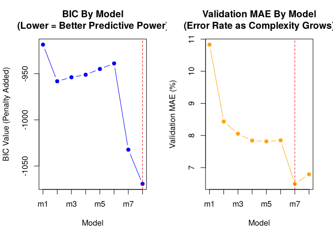

# Swing State Election Predictor

Can a county's demographics predict how it votes? We built county-level datasets for five states by combining U.S. Census demographics with 2016–2024 county presidential results, trained models on four states, and tested them on **Georgia**, a state the models had never seen.

*Team project for an upper-division machine learning class at UC Davis.*
**Team:** Iris Yuan, Alvin Guo, Nicholas Pinero, Naomi Cohen, Krishna Som



## Results
| Model | Predictors | Georgia validation MAE (Dem vote-share points) |
|---|---|---|
| Linear regression, 1 predictor (% Black) | 1 | 10.8 |
| Linear regression, best subset | 7 | **6.5** |
| Linear regression, best subset (lowest BIC) | 8 | 6.8 |
| Neural network (1 hidden layer, 3 units) | 11 | 6.9 |

- On a state it never trained on, the best model predicts each county's 2024 Democratic vote share within **~6.5 percentage points** on average.
- Best-subset selection added predictors in this order: % Black, % foreign-born, % without a high school diploma, % middle-aged, then poverty rate.
- BIC on the training states favored the full 8-variable model, but error on Georgia was lowest at 7 variables, which is a good example of in-sample and out-of-sample metrics disagreeing.

## What's inside
| Path | What it is |
|---|---|
| `analysis.Rmd` | Full analysis: EDA, cleaning, feature scaling, neural net tuning, best-subset regression, BIC + validation MAE |
| `analysis.md` | Rendered version you can read on GitHub (code, output, charts) |
| `data/` | One CSV per state: county demographics + 2016/2020/2024 results |
| `figures/` | Charts from the rendered analysis |

## Methods
1. **Data**: county demographics (age, race/ethnicity, foreign-born, income, poverty, education) from U.S. Census data, joined to county-level presidential returns for GA, IL, KY, MO, and TX.
2. **EDA**: correlation matrix to check multicollinearity; average demographics of red vs. blue counties.
3. **Design**: train on IL, KY, MO, TX; test on all 159 Georgia counties, so the evaluation measures generalization to a new state rather than to a random split.
4. **Models**: neural network (`nnet`, grid over hidden units × weight decay) and best-subset linear regression (`leaps`), compared on BIC and Georgia MAE.
5. **Maps**: actual vs. predicted Democratic share and prediction error by Georgia county (needs the `tigris` package and internet access).

## Run it
```r
install.packages(c("tidyverse", "nnet", "caret", "leaps", "corrplot", "patchwork", "tigris", "sf", "rmarkdown"))
rmarkdown::render("analysis.Rmd")
```

## Changes from the class version
- Removed the 2024 Republican vote share from the neural network's inputs. It is almost exactly 1 − the Democratic share (the target), so leaving it in leaked the answer and made the network look far better than it was. The neural network's tuning setting was updated to match the corrected results.
- Reorganized files into `data/` and `figures/`.

## Tools
R · tidyverse · nnet · leaps · caret · ggplot2 · patchwork · sf/tigris
