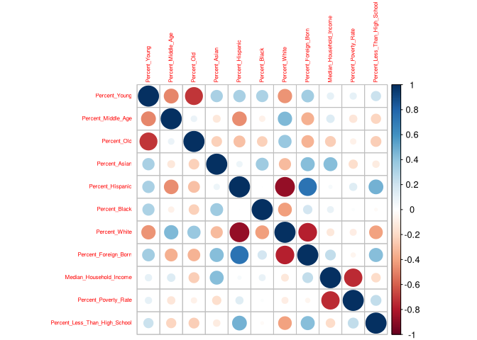
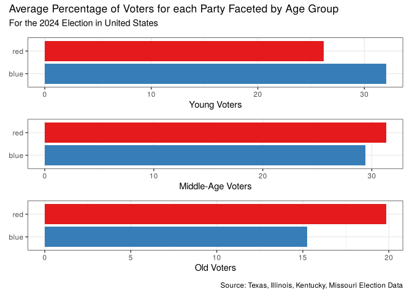
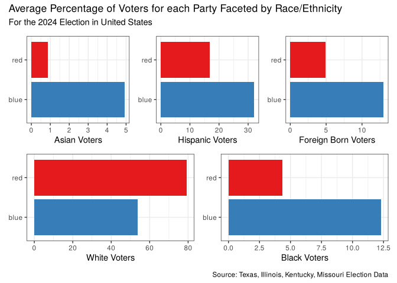
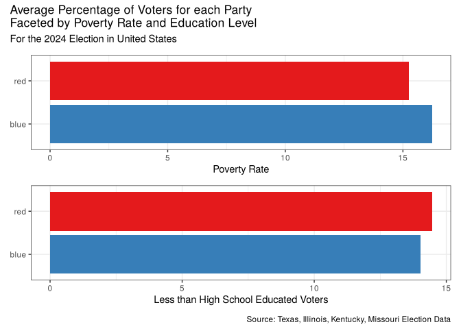
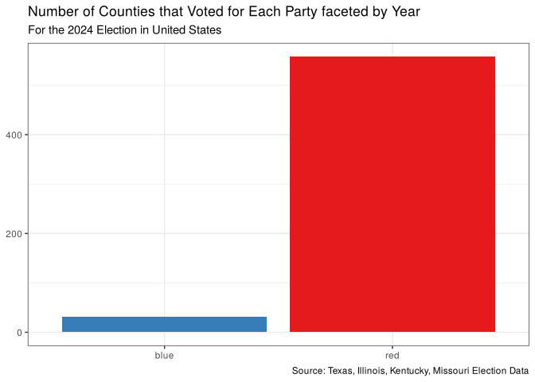
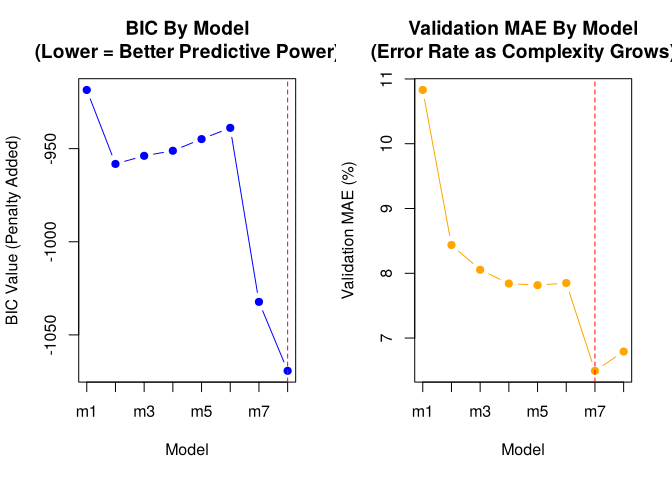

Swing State Election Predictor
================
Iris Yuan, Alvin Guo, Nicholas Pinero, Naomi Cohen, Krishna Som

``` r
# loading libraries needed
library(tidyverse)
library(nnet)
library(caret)
library(leaps)
library(corrplot)
library(patchwork)
```

``` r
# loading and cleaning datasets for counties
georgia <- read_csv("data/georgia_demo_election_data.csv")
illinois <- read_csv("data/illinois_demo_election_data.csv")
names(illinois)
```

    ##  [1] "County"                        "Percent_Young"                
    ##  [3] "Percent_Middle_Age"            "Percent_Old"                  
    ##  [5] "Percent_Asian"                 "Percent_Hispanic"             
    ##  [7] "Percent_Black"                 "Percent_White"                
    ##  [9] "Percent_Foreign_Born"          "Median_Household_Income"      
    ## [11] "Percent_Poverty_Rate"          "Percent_Less_Than_High_School"
    ## [13] "Percent_GOP_2024"              "Percent_Dem_2024"             
    ## [15] "Winner_2024"                   "Percent_GOP_2020"             
    ## [17] "Percent_Dem_2020"              "Winner_2020"                  
    ## [19] "Percent_GOP_2016"              "Percent_Dem_2016"             
    ## [21] "Winner_2016"

``` r
kentucky <- read_csv("data/kentucky_demo_election_data.csv")
texas <- read_csv("data/texas_demo_election_data.csv")[, ]
names(texas)[17] <- "Percent_Dem_2020"
names(texas)[14] <- "Percent_Dem_2024"
names(texas)[20] <- "Percent_Dem_2016"
missouri <- read_csv("data/missouri_demo_election_data.csv")
```

``` r
# Using copies of the data to perform Exploratory data analysis
# adding the winner's columns into Missouri data set for EDA
MO <- missouri %>%
  mutate(Winner_2016 = ifelse(Percent_GOP_2016>Percent_Dem_2016, "red","blue"),
         Winner_2020 = ifelse(Percent_GOP_2020>Percent_Dem_2020, "red","blue"),
         Winner_2024 = ifelse(Percent_GOP_2024>Percent_Dem_2024, "red","blue"))
GA <- georgia # copy of georgia's data for EDA
IL <- illinois
KY <- kentucky
TX <- texas

df <- rbind(MO, IL, KY, TX) # not including the test which is Georgia
df <- drop_na(df) # certain states have counties with the same name, causing 
# missing values to appear when joined, therefore we will drop those counties

# Exploratory data analysis
df_numerical <- df %>% select(where(is.numeric)) # Getting only the numerical columns
df_numerical <- df_numerical %>%
  select(-c(Percent_Dem_2016, Percent_Dem_2020, Percent_Dem_2024,
            Percent_GOP_2016, Percent_GOP_2020, Percent_GOP_2024))

# Plotting correlation plots to check for multi-collinearity
corrplot(cor(df_numerical), tl.cex = 0.5)
```

<!-- -->

``` r
# Summary Plots
# Making a summary dataframe that contains the mean percentage
mean_summary <- df %>%
  group_by(Winner_2024) %>%
  summarise(Percent_Young_Mean = mean(Percent_Young),
            Percent_Middle_Age_Mean = mean(Percent_Middle_Age),
            Percent_Old_Mean = mean(Percent_Old),
            Percent_Asian_Mean = mean(Percent_Asian),
            Percent_Hispanic_Mean = mean(Percent_Hispanic),
            Percent_Black_Mean = mean(Percent_Black),
            Percent_White_Mean = mean(Percent_White),
            Percent_Foreign_Born_Mean = mean(Percent_Foreign_Born),
            Percent_Poverty_Rate_Mean = mean(Percent_Poverty_Rate),
            Percent_Less_Than_High_School_Mean = mean(Percent_Less_Than_High_School))

# plot template
plot_meandemo <- function(yvar, axistitle){
  mean_summary %>%
    ggplot(aes(x = Winner_2024, fill = Winner_2024)) +
    geom_col(aes(y = yvar))+
    coord_flip()+
    scale_fill_brewer(palette = "Set1", direction = -1) +
    guides(fill = "none") +
    labs(x = NULL,
         y = axistitle,
         fill = NULL) +
    theme_bw()
}

# Plotting Each Demographic's Mean Percentage
plot1 <- plot_meandemo(yvar = mean_summary$Percent_Young_Mean,
                       axistitle = "Young Voters")

plot2 <- plot_meandemo(yvar = mean_summary$Percent_Middle_Age_Mean,
                       axistitle = "Middle-Age Voters")

plot3 <- plot_meandemo(yvar = mean_summary$Percent_Old_Mean,
                       axistitle = "Old Voters")

plot4 <- plot_meandemo(yvar = mean_summary$Percent_Asian_Mean,
                       axistitle = "Asian Voters")

plot5 <- plot_meandemo(yvar = mean_summary$Percent_Hispanic_Mean,
                       axistitle = "Hispanic Voters")

plot6 <- plot_meandemo(yvar = mean_summary$Percent_Black_Mean,
                       axistitle = "Black Voters")

plot7 <- plot_meandemo(yvar = mean_summary$Percent_White_Mean,
                       axistitle = "White Voters")

plot8 <- plot_meandemo(yvar = mean_summary$Percent_Foreign_Born_Mean,
                       axistitle = "Foreign Born Voters")

plot9 <- plot_meandemo(yvar = mean_summary$Percent_Poverty_Rate_Mean,
                       axistitle =  "Poverty Rate")

plot10 <- plot_meandemo(yvar = mean_summary$Percent_Less_Than_High_School_Mean,
                       axistitle = "Less than High School Educated Voters")

# Using patchwork to put multiple graphs on one grid
(plot1/plot2/plot3) + 
  plot_annotation(title = "Average Percentage of Voters for each Party Faceted by Age Group",
                  subtitle = "For the 2024 Election in United States",
                  caption = "Source: Texas, Illinois, Kentucky, Missouri Election Data")
```

<!-- -->

``` r
(plot4+plot5+plot8)/(plot7+plot6) +
  plot_annotation(title = "Average Percentage of Voters for each Party Faceted by Race/Ethnicity",
                  subtitle = "For the 2024 Election in United States",
                  caption = "Source: Texas, Illinois, Kentucky, Missouri Election Data")
```

<!-- -->

``` r
(plot9/plot10) +
  plot_annotation(title = "Average Percentage of Voters for each Party \nFaceted by Poverty Rate and Education Level",
                  subtitle = "For the 2024 Election in United States",
                  caption = "Source: Texas, Illinois, Kentucky, Missouri Election Data")
```

<!-- -->

``` r
# Summary plot of the Winners for each state in 2024's election
winners <- df %>%
  select(c(Winner_2024))
winners <- pivot_longer(winners, cols = Winner_2024, names_to = "Year", values_to = "Winner")

winners <- winners %>%
  mutate(Year = str_replace_all(Year, "Winner_2024", "2024")) %>%
  group_by(Year, Winner) %>%
  summarize(`Number of Counties that Voted for Each Party` = n())

winners %>%
  ggplot(aes(x = Winner, y = `Number of Counties that Voted for Each Party`, fill = Winner)) +
  geom_col() +
  scale_fill_brewer(palette = "Set1", direction = -1) + 
  theme_bw() +
  guides(fill = "none" )+
  labs(x = NULL,
       y = NULL,
       title = "Number of Counties that Voted for Each Party faceted by Year",
       subtitle = "For the 2024 Election in United States",
       caption = "Source: Texas, Illinois, Kentucky, Missouri Election Data")
```

<!-- -->

``` r
#remove winners column
georgiaNoWinners <- georgia[, -c(15, 18, 21)]
illinoisNoWinners <- illinois[, -c(15, 18, 21)]
kentuckyNoWinners <- kentucky[, -c(15, 18, 21)]
texasNoWinners <- texas[, -c(15, 18, 21)]


#train set will be states not including georgia, test will be georgia
countiesCombinedTrain <- bind_rows(illinoisNoWinners, kentuckyNoWinners, texasNoWinners, missouri)
countiesCombinedTrain <- na.omit(countiesCombinedTrain)
georgiaTest <- georgiaNoWinners

# turn percentages into decimal form
countiesCombinedTrain[,c(2:9, 11:12)] <- countiesCombinedTrain[,c(2:9, 11:12)] * .01
georgiaTest[,c(2:9, 11:12)] <- georgiaTest[,c(2:9, 11:12)] * .01

#drop county names, 2020 and 2016 results, and the 2024 GOP share
# (GOP share is roughly 1 - Dem share, so keeping it would leak the answer)
countiesCombinedTrain <- countiesCombinedTrain %>% select(-County, -Percent_GOP_2024, -Percent_GOP_2020, -Percent_Dem_2020, -Percent_GOP_2016, -Percent_Dem_2016)
georgiaTest <- georgiaTest %>% select(-County, -Percent_GOP_2024, -Percent_GOP_2020, -Percent_Dem_2020, -Percent_GOP_2016, -Percent_Dem_2016)
```

``` r
# min max scaling median household
min_med_household <- min(countiesCombinedTrain$Median_Household_Income)
max_med_household <- max(countiesCombinedTrain$Median_Household_Income)

countiesCombinedTrain$Median_Household_Income <- 
  (countiesCombinedTrain$Median_Household_Income - min_med_household)/
  (max_med_household - min_med_household)

georgiaTest$Median_Household_Income <- 
  (georgiaTest$Median_Household_Income - min_med_household)/
  (max_med_household - min_med_household)
```

``` r
set.seed(1)
# nnet training for regression, 
RMSETable <- matrix(0, 3, 3)
MAETable <- matrix(0, 3, 3)

decayParameter <- c(.1, .01, .001)
for (i in 1:3) 
{
  for (j in 1:3) 
  {
    learning_model <- nnet(Percent_Dem_2024 ~. , data = countiesCombinedTrain, size = i, maxit = 100, decay = decayParameter[j], linout = TRUE)
    predictions <- predict(learning_model, newdata = georgiaTest)

    RMSETable[i, j] <- RMSE(predictions, georgiaTest$Percent_Dem_2024)
    MAETable[i, j] <- mean(abs(predictions - georgiaTest$Percent_Dem_2024))
  }
  
}
```

``` r
#Looking at RMSE and MAE table

rownames(RMSETable) <- c("Units in HL = 1: ", "Units in HL = 2" , 
                         "Units in HL = 3" )
colnames(RMSETable) <- c("decay = .1", "decay = .01", "decay = .001")

rownames(MAETable) <- c("Units in HL = 1: ", "Units in HL = 2" , 
                         "Units in HL =3" )
colnames(MAETable) <- c("decay = .1", "decay = .01", "decay = .001")

cat("Models RMSE \n")
```

    ## Models RMSE

``` r
RMSETable
```

    ##                   decay = .1 decay = .01 decay = .001
    ## Units in HL = 1:  0.08790067  0.09108883   0.09715538
    ## Units in HL = 2   0.08603909  0.09787577   0.10163305
    ## Units in HL = 3   0.08601723  0.09448024   0.09253367

``` r
cat("Models MAE \n")
```

    ## Models MAE

``` r
MAETable
```

    ##                   decay = .1 decay = .01 decay = .001
    ## Units in HL = 1:  0.06973336  0.06926533   0.07276097
    ## Units in HL = 2   0.06879997  0.07464166   0.07622819
    ## Units in HL =3    0.06878895  0.07898637   0.07782096

``` r
#final model with size = 3 and decay = .1 (lowest validation error in the tables above)
set.seed(1)
    finalModel <- nnet(Percent_Dem_2024 ~. , data = countiesCombinedTrain, size = 3, maxit = 100, decay = .1, linout = TRUE)
```

    ## # weights:  40
    ## initial  value 14.213915 
    ## iter  10 value 6.316006
    ## iter  20 value 5.996291
    ## iter  30 value 5.904029
    ## iter  40 value 5.841589
    ## iter  50 value 5.823134
    ## iter  60 value 5.810797
    ## iter  70 value 5.803676
    ## iter  80 value 5.800470
    ## iter  90 value 5.800150
    ## iter 100 value 5.800133
    ## final  value 5.800133 
    ## stopped after 100 iterations

``` r
# MLR

train_data <- countiesCombinedTrain
val_data   <- georgiaTest
```

``` r
# Best Subset Selection

bestModel_search <- regsubsets(Percent_Dem_2024 ~ ., data = train_data, nvmax = 8)

search_summary <- summary(bestModel_search)

m1 <- lm(Percent_Dem_2024 ~ Percent_Black, data = train_data)
m2 <- lm(Percent_Dem_2024 ~ Percent_Black + Percent_Foreign_Born, data = train_data)
m3 <- lm(Percent_Dem_2024 ~ Percent_Black + Percent_Foreign_Born + Percent_Less_Than_High_School, data = train_data)
m4 <- lm(Percent_Dem_2024 ~ Percent_Black + Percent_Foreign_Born + Percent_Less_Than_High_School + Percent_Middle_Age, data = train_data)
m5 <- lm(Percent_Dem_2024 ~ Percent_Black + Percent_Foreign_Born + Percent_Less_Than_High_School + Percent_Middle_Age + Percent_Poverty_Rate, data = train_data)
m6 <- lm(Percent_Dem_2024 ~ Percent_Black + Percent_Foreign_Born + Percent_Less_Than_High_School + Percent_Middle_Age + Percent_Poverty_Rate + Percent_Hispanic, data = train_data)
m7 <- lm(Percent_Dem_2024 ~ Percent_Black + Percent_Foreign_Born + Percent_Less_Than_High_School + Percent_Middle_Age + Percent_Poverty_Rate + Percent_Hispanic + Percent_Asian, data = train_data)
m8 <- lm(Percent_Dem_2024 ~ Percent_Black + Percent_Foreign_Born + Percent_Less_Than_High_School + Percent_Middle_Age + Percent_Poverty_Rate + Percent_Hispanic + Percent_Asian + Median_Household_Income, data = train_data)

models_list <- list(m1, m2, m3, m4, m5, m6, m7, m8)
model_names <- paste0("m", 1:8)
```

``` r
# Model Metrics

# BIC
bic_values <- sapply(models_list, BIC)
best_model_idx <- which.min(bic_values)

bic_df <- data.frame(Model = model_names, BIC = round(bic_values, 2))
print("Training BIC Metric Output")
```

    ## [1] "Training BIC Metric Output"

``` r
print(bic_df)
```

    ##   Model      BIC
    ## 1    m1  -918.49
    ## 2    m2  -958.21
    ## 3    m3  -953.86
    ## 4    m4  -951.13
    ## 5    m5  -944.88
    ## 6    m6  -938.85
    ## 7    m7 -1032.27
    ## 8    m8 -1069.31

``` r
# Validation Error MAE
compute_mae <- function(mod, data) {
  preds <- predict(mod, newdata = data)
  mean(abs(data$Percent_Dem_2024 - preds))
}

val_mae <- sapply(models_list, compute_mae, data = val_data)

mae_df <- data.frame(
  Model           = model_names,
  Num_Predictors  = 1:8,
  Validation_MAE  = round(val_mae * 100, 3)
)
print("MAE Validation")
```

    ## [1] "MAE Validation"

``` r
print(mae_df)
```

    ##   Model Num_Predictors Validation_MAE
    ## 1    m1              1         10.830
    ## 2    m2              2          8.436
    ## 3    m3              3          8.054
    ## 4    m4              4          7.842
    ## 5    m5              5          7.816
    ## 6    m6              6          7.850
    ## 7    m7              7          6.494
    ## 8    m8              8          6.791

``` r
par(mfrow = c(1, 2))
 
# BIC Curve
plot(1:8, bic_values,
     type  = "b",
     pch   = 19,
     col   = "blue",
     xaxt  = "n",
     xlab  = "Model",
     ylab  = "BIC Value (Penalty Added)",
     main  = "BIC By Model\n(Lower = Better Predictive Power)") 
axis(1, at = 1:8, labels = model_names) 
abline(v   = best_model_idx, lty = 2, col = "red")
text(best_model_idx, max(bic_values), pos = 4, col = "red", cex = 0.8)

# MAE Curve

plot(1:8, val_mae * 100,
     type  = "b",
     pch   = 19,
     col   = "orange",
     xaxt  = "n",
     xlab  = "Model",
     ylab  = "Validation MAE (%)",
     main  = "Validation MAE By Model\n(Error Rate as Complexity Grows)") 
axis(1, at = 1:8, labels = model_names) 
abline(v   = which.min(val_mae), lty = 2, col = "red")
```

<!-- -->

``` r
par(mfrow = c(1, 1))
```

### Mapping prediction error in Georgia

*Needs the `tigris` package and an internet connection to download
Georgia county boundaries from the U.S. Census Bureau.*

``` r
# map graph to show the voting results weighed by population 
library(tigris)
library(sf)
library(dplyr)
library(ggplot2)

# Georgia county shapes
ga_counties <- counties(state = "GA", cb = TRUE, year = 2020) %>%
  mutate(County = paste0(NAME, " County"))

# Scale georgia the same way georgiaTest was scaled
georgia_scaled <- georgia %>%
  mutate(across(c(Percent_Young, Percent_Middle_Age, Percent_Old,
                  Percent_Asian, Percent_Hispanic, Percent_Black,
                  Percent_White, Percent_Foreign_Born,
                  Percent_Poverty_Rate, Percent_Less_Than_High_School),
                ~ . * 0.01),
         Median_Household_Income = (Median_Household_Income - min_med_household) /
                                   (max_med_household - min_med_household))

# Join with scaled georgia
map_df <- ga_counties %>%
  left_join(georgia_scaled, by = "County")

# Map 1: Actual 2024 Democratic vote share
ggplot(map_df) +
  geom_sf(aes(fill = Percent_Dem_2024), color = "white", linewidth = 0.2) +
  scale_fill_gradient2(
    low = "#B2182B", mid = "white", high = "#2166AC",
    midpoint = 0.5,
    labels = scales::percent_format(accuracy = 1),
    name = "Dem Vote %") +
  labs(title = "2024 Democratic Vote Share by Georgia County",
       caption = "Source: Georgia election data") +
  theme_void() +
  theme(legend.position = "right")

# Map 2: Prediction error using m8
map_df <- map_df %>%
  mutate(
    Predicted_Dem_2024 = predict(m8, newdata = map_df),
    Pred_Error = Predicted_Dem_2024 - Percent_Dem_2024)

ggplot(map_df) +
  geom_sf(aes(fill = Pred_Error), color = "white", linewidth = 0.2) +
  scale_fill_gradient2(
    low = "#B2182B", mid = "white", high = "#2166AC",
    midpoint = 0,
    labels = scales::percent_format(accuracy = 1),
    name = "Predicted\n- Actual") +
  labs(title = "Model Prediction Error by Georgia County",
       subtitle = "Blue = model overestimated Dem share, Red = underestimated",
       caption = "Counties with large errors highlight model limitations") +
  theme_void() +
  theme(legend.position = "right")

# top 5 counties with largest prediction error
map_df %>%
  st_drop_geometry() %>%
  mutate(Abs_Error = abs(Pred_Error)) %>%
  arrange(desc(Abs_Error)) %>%
  select(County, Percent_Dem_2024, Predicted_Dem_2024, Pred_Error) %>%
  head(5)
```
